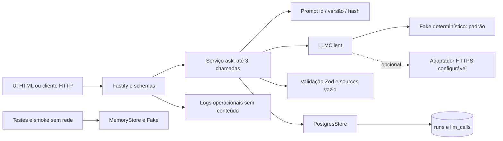

# Arquitetura da Fase 1



```mermaid
sequenceDiagram
  participant U as Cliente
  participant API as Fastify
  participant A as ask
  participant DB as Store
  participant L as LLMClient
  U->>API: POST /v1/ask ou /v1/ask/stream
  alt Body inválido ou grande
    API-->>U: Erro 4xx com requestId
  else Entrada válida
    opt SSE
      API-->>U: event status
    end
    API->>A: Pergunta e requestId
    A->>DB: Criar run e metadados do prompt
    loop No máximo 3 tentativas
      A->>DB: Criar llm_call running
      A->>L: complete com timeout
      alt Resposta recebida
        L-->>A: Texto, usage, modelo, latência
        A->>A: Parse, schema, fontes, custo
        A->>DB: Tokens/custo/status/is_simulated
      else Timeout ou erro do provedor
        A->>DB: Status de erro; usage desconhecido
        A-->>API: Erro controlado
      end
      Note over A: Encerra ao validar; repara apenas saída inválida
    end
    A->>DB: Run completed ou failed
    A-->>API: Resposta validada ou erro
    API-->>U: JSON / evento result ou error
  end
```

O diagrama inclui a persistência planejada e implementada, não uma afirmação de validação em PostgreSQL real. Docker e integração real aguardam a execução local do usuário. Falha do banco impede sucesso HTTP; métricas de chamadas concluídas podem ficar incompletas se o banco cair após o retorno do LLM.
